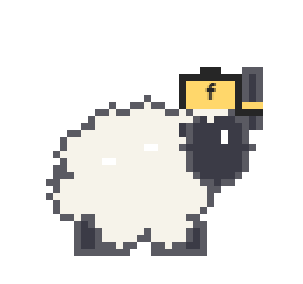
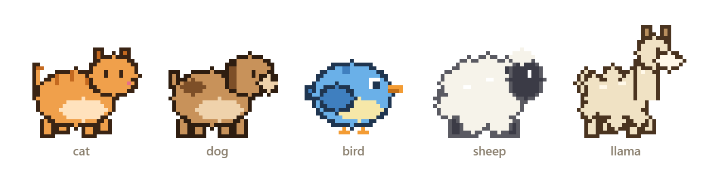
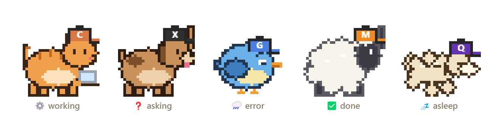
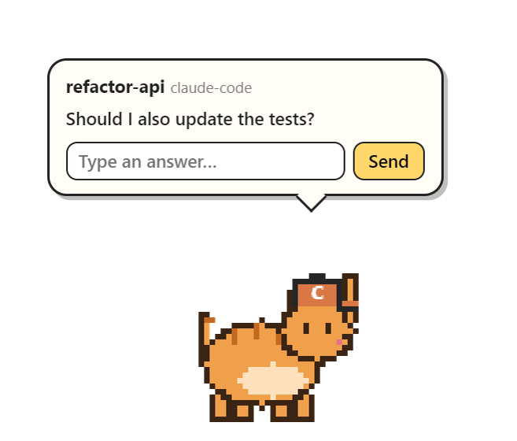
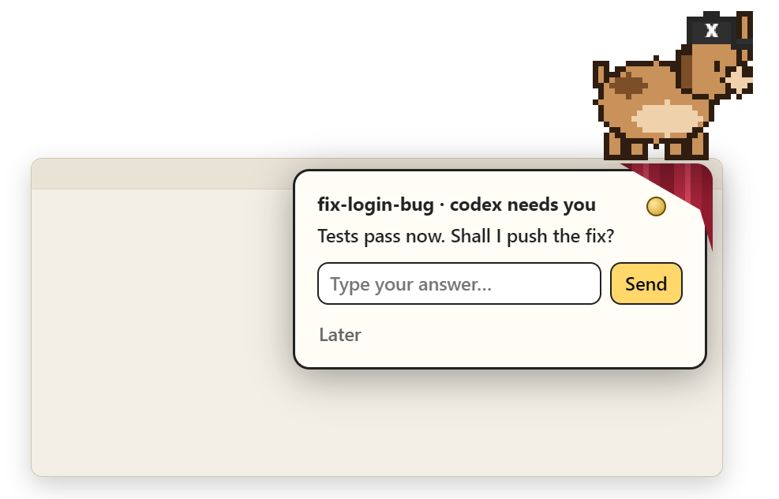
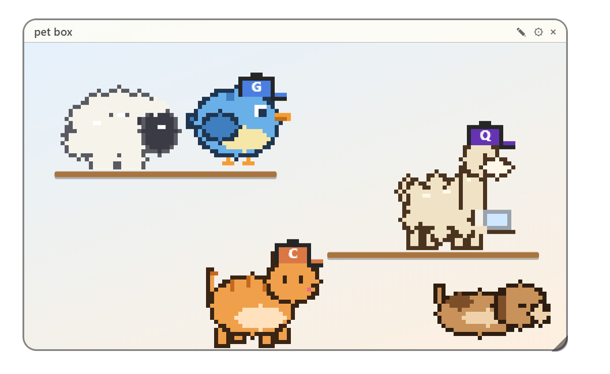
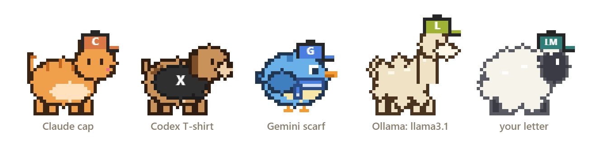
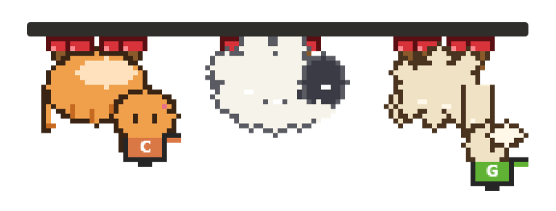
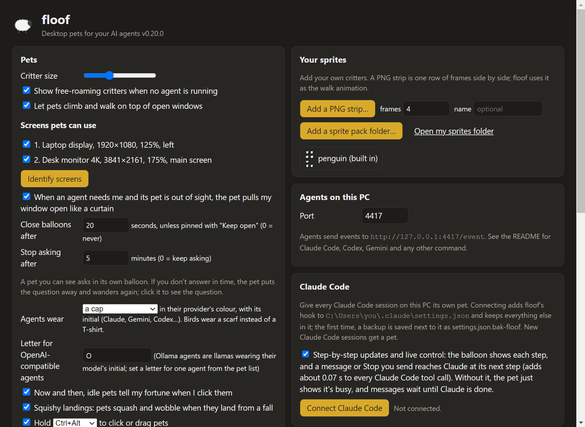
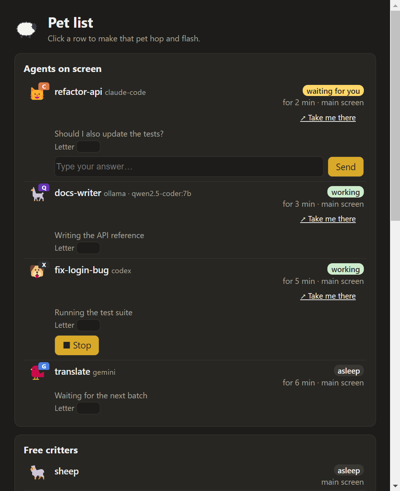

<div align="center">



# floof

**Desktop pets for your AI agents.** Every agent you run, on your PC or in the cloud, from any provider, gets its own fluffy critter on your Windows desktop.


[](LICENSE)


[Features](#features) · [Install](#install) · [Connect your agents](#connect) · [Settings](#settings) · [Your own sprites](#sprites) · [FAQ](#faq)



</div>

In the spirit of Sheep.exe: pets walk along the taskbar, climb onto your windows and ride along when you move them, chat when they meet and cheer each other up. Click a pet to see what its agent is doing. When an agent needs you, its pet asks in a talking balloon, pulls the corner of your window open like a curtain, or pops up next to the clock, and Windows shows a notification too.

<div align="center">

</div>

---

<a id="features"></a>

## ✨ Features

### 🐾 Pets and critters
- **Five built-in critters:** cat, dog, bird, sheep and llama, drawn as pixel art, plus your own sprites.
- **One pet per agent**, and a few free-roaming critters if you like.
- **They live on your desktop:** they walk on the taskbar and on window tops, ride along when you move a window, cross between monitors, and can be dragged and thrown.
- **Sleepy by default:** idle pets nap where they are (💤) until you click them. Only busy agents and ones waiting for you move around.

### 💬 Agents and questions
| Agent state | What you see |
| --- | --- |
| ⚙️ `working` | types on a little laptop or walks around, with a progress bar |
| ❓ `question` | asks you, with a box to answer (see below) |
| 🌧️ `error` | gets a little sad; friends come over to cheer it up |
| ✅ `done` | jumps for joy |
| 💤 `idle` | naps until you click it |
| 👋 `bye` | walks off the screen |

When an agent needs you:
- **In sight:** a pet you can see asks in its own balloon.
- **Out of sight:** it pulls the corner of the window you're using open like a curtain.
- **No room, or a window pets must keep off:** it pops up from the taskbar next to the clock.
- Windows shows a notification as well. Unanswered questions are put away after a while (5 minutes by default).

<div align="center">

&nbsp;&nbsp;

</div>

### 🐣 Subagents
- **Minis:** when an agent starts subagents, its pet gets small copies of itself that trot after it, up to 3 at a time. Running ones go first.
- **Naps on the back:** when a subagent finishes, its mini jumps onto the pet's back and sleeps there (🌧️ if it ended in an error). A newer one takes its place.
- **Counted in the balloon:** 🐣 2 / 5 means 2 still running out of 5 this turn. Hover over it to see them all.
- **Listed in the pet list:** a row for each one under its agent, with what it's doing.
- **Questions:** a subagent's question is asked in its agent's balloon, with the subagent's name in front, and your answer goes to the subagent.
- **A new turn starts fresh:** when the agent gets your next message, its earlier subagents go.
- Claude Code's subagents work once it's connected. Other agents send events with a `parent` ([see the API](#api)). Turn minis off in Settings if you'd rather not see them.

### 🎮 Control
- **🔑 Hold Ctrl+Alt to interact.** Without the keys, clicks go straight through and pets get out of the way of your mouse and of where you're typing.
- **✉️ Message and ■ Stop** an agent from its balloon or the pet list.
- **↗ Take me there** brings an agent's window to the front, or opens a cloud agent's page.
- **📋 Pet list:** every pet and what it's doing, plus agents that have finished. **×** sends a free critter away, dismisses an agent's pet that's stuck around, or removes a finished row.

### 🏠 Where pets live
- **Everywhere**, or **only on the windows you choose** (by app, or a single window by its title).
- **Keep pets off** apps, single windows and full-screen games and videos.
- **Choose which screens** they use.
- **📦 Pet boxes:** cosy boxes on your desktop with shelves you arrange, a background colour or picture, and gravity you can turn off.

<div align="center">

</div>

### 🎉 Fun
- **🧢 Caps and T-shirts** in each provider's colour with its initial. Birds get a scarf.
- **🦙 Llamas for Ollama,** wearing the initial of the model they serve.
- **🪠 Plungers:** with a taskbar at the top or side, pets hang on to it upside down or sideways.
- **🫠 Squishy landings:** a pet that falls squashes flat and wobbles back, with a puff of dust after a big drop and, now and then, a second of dizzy stars.
- **🥠 Fortunes** from idle pets.
- **🐑 A guide sheep** shows you around on first run.

<div align="center">

<br />

</div>

---

<a id="install"></a>

## 📦 Install

floof runs on **Windows 10 and 11**.

1. Download `floof-<Major.Minor.Patch>-win-x64.zip`.
2. Unzip it anywhere and run **`floof.exe`**. Nothing gets installed.
3. A sheep appears in the system tray:
   - **Right-click** it to add or remove critters, run the demo agents, open the pet list or Settings, take the tour, or quit.
   - **Double-click** it to open Settings.

> [!NOTE]
> floof isn't code-signed yet, so Windows SmartScreen may warn the first time. Choose **More info**, then **Run anyway**.

**From source** (needs Node.js 18 or newer): `npm install`, then `npm run demo` (with three fake agents) or `npm start`. To do it without Node.js, see [Development](#development).

---

<a id="connect"></a>

## 🔌 Connect your agents

floof listens on `http://127.0.0.1:4417`, so only your own PC can reach it. Every adapter just sends small JSON events there.

###  Claude Code

**Settings › Claude Code › Connect Claude Code.** That's all.

- floof adds its hook, `tools/claude-code-hook.exe`, to `%USERPROFILE%\.claude\settings.json` and keeps everything else in it. The first time, it saves a backup next to it.
- **Disconnect** takes floof's hooks out again.
- Each Claude Code session gets its own pet, named after its project folder.
- Its subagents get minis: small copies of the pet that trot after it. The newest one to finish naps on its back. The balloon shows how many are running (🐣 2 / 5), and the pet list shows them all. If you connected with an older floof, it adds the `SubagentStart` and `SubagentStop` hooks by itself the next time it starts.
- The hook takes about 70 ms per call (about 40 ms when floof isn't running) and always exits cleanly.
- **Step-by-step updates and live control** (on by default) shows each step in the balloon, and lets a message or Stop reach Claude at its next step.

<details>
<summary>Other ways to hook Claude Code (Node.js, curl, PowerShell)</summary>

With Node.js, add this to `%USERPROFILE%\.claude\settings.json` (with the real path to floof's `tools` folder):

```json
{
  "hooks": {
    "SessionStart":     [{ "hooks": [{ "type": "command", "command": "node C:/path/to/floof/tools/claude-code-hook.js" }] }],
    "UserPromptSubmit": [{ "hooks": [{ "type": "command", "command": "node C:/path/to/floof/tools/claude-code-hook.js" }] }],
    "PreToolUse":       [{ "hooks": [{ "type": "command", "command": "node C:/path/to/floof/tools/claude-code-hook.js" }] }],
    "Notification":     [{ "hooks": [{ "type": "command", "command": "node C:/path/to/floof/tools/claude-code-hook.js" }] }],
    "Stop":             [{ "hooks": [{ "type": "command", "command": "node C:/path/to/floof/tools/claude-code-hook.js" }] }],
    "SessionEnd":       [{ "hooks": [{ "type": "command", "command": "node C:/path/to/floof/tools/claude-code-hook.js" }] }],
    "SubagentStart":    [{ "hooks": [{ "type": "command", "command": "node C:/path/to/floof/tools/claude-code-hook.js" }] }],
    "SubagentStop":     [{ "hooks": [{ "type": "command", "command": "node C:/path/to/floof/tools/claude-code-hook.js" }] }]
  }
}
```

Without Node:
- `curl.exe -s -m 1 -H "Content-Type: application/json" --data-binary @- http://127.0.0.1:4417/hook/claude-code`: about 30 ms, but it reports an error to Claude Code when floof isn't running.
- `powershell -NoProfile -ExecutionPolicy Bypass -File C:/path/to/floof/tools/claude-code-hook.ps1`: about 300 ms per call.

`claude-code-hook.exe` is built from `tools/claude-code-hook.cs` by `tools/build-hook.ps1`, using the C# compiler that comes with Windows. It isn't kept in git, so run that script once after cloning.

</details>

###  Codex CLI

Add this to `%USERPROFILE%\.codex\config.toml`:

```toml
notify = ["node", "C:/path/to/floof/tools/codex-notify.js"]
```

Codex only reports when a turn finishes, so the pet appears with ✅ and Codex's last message. For live updates, start Codex through `floof-run` (below).

###  Gemini CLI

Gemini CLI has hooks much like Claude Code's. Add the same block to `%USERPROFILE%\.gemini\settings.json`, using `gemini-hook.js` and Gemini's event names: `SessionStart`, `BeforeAgent`, `BeforeTool`, `Notification`, `AfterAgent`, `SessionEnd`. This adapter hasn't been tried against a real Gemini CLI yet.

### 🦙 Ollama and OpenAI-compatible models

**Ollama** agents (provider `ollama`) are always llamas, wearing the initial of their model in a colour for that model family: `qwen2.5-coder:7b` gives a "Q", `library/llama3.1` an "L". floof-run reads the model from `ollama run <model>` by itself:

```powershell
node C:/path/to/floof/tools/floof-run.js --watch -- ollama run qwen2.5-coder:7b
```

**OpenAI-compatible** agents (provider `openai-compatible`, for LM Studio, vLLM, llama.cpp and the like) wear "O", or the letter you set in Settings:

```powershell
node C:/path/to/floof/tools/send-event.js my-bot working "Thinking" --provider openai-compatible --model mixtral --badge LM
```

### 🧰 Any other command

`floof-run.js` gives a pet to any command: aider, a Python script that calls an API, anything.

```powershell
node C:/path/to/floof/tools/floof-run.js --name my-job --critter sheep -- python my_agent.py
node C:/path/to/floof/tools/floof-run.js --watch -- aider
```

The pet shows ⚙️ while the command runs, then ✅ or 🌧️ depending on how it exits.
- **With `--watch`**, it also shows the latest output line and asks you when the output looks like a question. Leave it off for full-screen terminal apps.
- **■ Stop** in the balloon ends the command.

<a id="api"></a>

### 🧑‍💻 Your own code

<details>
<summary>The HTTP API: events, answers, messages and Stop</summary>

Send `POST http://127.0.0.1:4417/event`:

```json
{ "id": "my-agent-1", "state": "working", "text": "Reading files", "name": "my-task", "provider": "mistral", "critter": "sheep", "progress": 0.3 }
```

| Field | |
| --- | --- |
| `id`, `state` | required. State is `idle`, `working`, `question`, `done`, `error` or `bye` |
| `text`, `name`, `provider`, `progress` | what the balloon and pet list show |
| `critter` | `cat`, `dog`, `bird`, `sheep`, `llama` or a sprite pack name |
| `model`, `badge` | the model (Ollama letters), or your own 1–2 letters for the cap |
| `controls` | `["message", "stop"]`: what the balloon offers |
| `pids`, `url` | for ↗ Take me there: your process id, or a web page |
| `parent` | the `id` of the agent this one is a subagent of: it shows as a mini that follows that agent's pet. Its `done` or `error` puts the mini to sleep on the pet's back; `bye` removes it. |

Answers typed into a balloon wait at `GET /answers/<id>`. Messages and Stop wait at `GET /control/<id>` as `{"messages": [...], "stop": true|false}`. Both are cleared once read. Scripts can send a message or Stop with `POST /control/<id>`.

```powershell
Invoke-RestMethod -Method Post -Uri http://127.0.0.1:4417/event -ContentType 'application/json' -Body '{"id":"test","state":"question","text":"Can I delete the old folder?"}'
Invoke-RestMethod http://127.0.0.1:4417/answers/test
```

Or: `node tools/send-event.js test working "Hello" --critter cat --progress 0.5`.

</details>

### ☁️ Cloud agents

Cloud agents can't reach your PC directly, so floof can listen on a private [ntfy](https://ntfy.sh) topic instead.
1. Turn on **Receive events from agents running in the cloud** in Settings > Cloud agents. The status there should say **Connected**.
2. Click **Send test event**: it posts to your topic and waits for it to come back, so you know the path works.
3. **Copy address**, and have the cloud agent post the same JSON events to it (examples below).

**Claude Code on the web:** add floof's hook to the repository's `.claude/settings.json`, for the same events as the local hook (Settings shows the command with your topic; **Copy hook command**):

```json
{ "type": "command", "command": "curl -s -m 5 --data-binary @- https://ntfy.sh/<your-topic> > /dev/null || true" }
```

The hook passes Claude Code's own payload straight to the topic, and the cloud environment needs network access to `ntfy.sh` (a custom allowlist or full access). Events only go one way, so a cloud session's pet has no message box or Stop.

<details>
<summary>Examples (curl, PowerShell, Python)</summary>

bash, macOS or Linux (and Git Bash):

```bash
curl -d '{"id":"job-42","state":"working","text":"Training the model","provider":"openai","url":"https://example.com/job/42"}' https://ntfy.sh/<your-topic>
```

Windows PowerShell:

```powershell
Invoke-RestMethod -Method Post -Uri https://ntfy.sh/<your-topic> -Body '{"id":"job-42","state":"working","text":"Training the model","provider":"openai","url":"https://example.com/job/42"}'
```

Windows Command Prompt (cmd keeps single quotes and drops double ones, so the quotes inside are escaped):

```bat
curl -d "{\"id\":\"job-42\",\"state\":\"working\",\"text\":\"Training the model\",\"provider\":\"openai\",\"url\":\"https://example.com/job/42\"}" https://ntfy.sh/<your-topic>
```

If a message can't be read, Settings > Cloud agents shows it, so a shell that ate the quotes is easy to spot.

```python
import json, requests
requests.post("https://ntfy.sh/<your-topic>", data=json.dumps({"id": "job-42", "state": "question", "text": "Deploy to staging?"}))
# answers, messages and Stop arrive as {"id", "text"} or {"id", "type": "message" | "stop", "text"} in the "message" field of:
requests.get("https://ntfy.sh/<your-topic>-answers/json?poll=1&since=10m").text
```

</details>

---

<a id="settings"></a>

## ⚙️ Settings

Open Settings from the tray menu, or double-click the sheep.

<div align="center">

<br />

</div>

| Setting | What it does |
| --- | --- |
| **Critter size** | how big the built-in critters are |
| **Free-roaming critters** | pets with no agent, just for company. Send one away from its balloon or the pet list and it stays away; ticking this again brings them all back |
| **Hold keys to click or drag pets** | Ctrl+Alt by default; without the keys pets keep out of your way |
| **Idle pets sleep until I click them** | otherwise everyone wanders |
| **Show agents' subagents as small pets** | minis that follow their agent's pet (on by default). Off hides only the minis: the balloon count and the pet list still show subagents |
| **Agents wear** | a cap, a T-shirt, both or nothing, in the provider's colour |
| **Letter for OpenAI-compatible agents** | "O" by default |
| **Screens pets can use** | untick screens to keep pets off them; **Identify screens** numbers them |
| **Where pets live** | everywhere, only on the windows you choose, or in pet boxes |
| **Pet boxes** | background (colour or picture), shelf colour, gravity, for each box and for new ones |
| **Curtain, close balloons after, stop asking after** | how questions get your attention, and for how long |
| **Keep pets off** | apps and single windows (by title), and full-screen windows |
| **Fortunes** | idle pets tell your fortune now and then |
| **Squishy landings** | pets squash and wobble when they land from a fall (on by default) |
| **Notifications** | questions, errors, finished |
| **Claude Code** | Connect / Disconnect, step-by-step updates and live control |
| **Your sprites** | add a PNG strip or a sprite pack folder |
| **Port, cloud agents, start at sign-in** | the rest |

<details>
<summary>More about pet boxes, shelves, keep-off rules, screens and plungers</summary>

- **Pet boxes:** add one from the tray menu or Settings.
  - Drag its title bar to move it, drag the corner to resize it, and × removes it.
  - ✎ arranges its shelves: **+ shelf** adds one, drag a shelf to move it, drag its ends to resize it, and press Esc when you're done.
  - ⚙ opens its background, shelf colour and gravity.
  - Pictures you pick are copied into floof's own folder.
- **Window rules:** "Pick an open window" fills in a rule for that app with text from its title, which you can shorten. For example, `firefox` + `YouTube` keeps pets off YouTube but not your other Firefox windows.
- **Screens:** pets never go onto an unticked screen, and floof doesn't even draw there. Pet boxes on it wait until you tick it again.
- **Plungers:** with a taskbar at the top, left or right, pets now and then hang on to it, and questions pop out of that edge next to the clock. An auto-hidden taskbar counts as a bottom one.

</details>

---

<a id="sprites"></a>

## 🎨 Bring your own sprites

Settings › **Your sprites**:
- **Add a PNG strip:** one row of frames side by side. floof uses it as the walk animation.
- **Add a sprite pack folder:** a PNG sheet plus a `sprite.json`, for full control. See `sprites/penguin/` for a working example.

<details>
<summary><code>sprite.json</code> format</summary>

```json
{
  "name": "penguin",
  "sheet": "sheet.png",
  "frameWidth": 24,
  "frameHeight": 24,
  "scale": 4,
  "facing": "right",
  "hat": { "x": 13, "y": 4 },
  "body": { "x": 12, "y": 15 },
  "animations": {
    "idle":  { "row": 0, "frames": 2, "fps": 2 },
    "walk":  { "row": 1, "frames": 2, "fps": 6 },
    "sleep": { "row": 2, "frames": 1, "fps": 1 },
    "wave":  { "row": 3, "frames": 2, "fps": 4 }
  }
}
```

- **Animations:** each one is a row of the sheet, frames left to right. The names floof uses are `idle`, `walk`, `sleep`, `work`, `wave`, `pull`, `celebrate`, `sad`, `fall`, `drag`, `fly` and `chat`. Missing ones fall back to `idle`, then `walk`. A pack without `sad` frames droops and turns a little grey instead.
- **Caps and T-shirts:** `hat` and `body` say where the head and chest are (in frame pixels, facing right). They're optional: without them, floof finds the head and chest from the sprite itself.
- **Where packs live:** `%APPDATA%\floof\sprites`.

</details>

---

## 🔒 Privacy and security

- **Local only:** floof's API listens on `127.0.0.1`, so only programs on your own PC can talk to it.
- **Keep your relay topic secret:** cloud agents use a private ntfy topic, and anyone who knows its name can talk to your pets. Settings can make a new one, or you can point floof at your own ntfy server.
- **Links:** ↗ Take me there only opens `http` and `https` links, and shows the site before you click.
- **Your data stays on your PC:** settings, history and box pictures are in `%APPDATA%\floof`. Nothing is sent anywhere unless you turn on the cloud relay.

<a id="faq"></a>

## ❓ FAQ

<details>
<summary><b>The pets block my clicks.</b></summary>

They shouldn't. Unless you hold Ctrl+Alt, clicks go straight through pets. Check Settings › Pets › Hold keys to click or drag pets.
</details>

<details>
<summary><b>Do they use much CPU?</b></summary>

About 15–25% of one CPU core on a 4K screen with several pets, mostly the GPU drawing the transparent overlay. Sleeping pets cost almost nothing.
</details>

<details>
<summary><b>Pets don't cross to my second monitor.</b></summary>

They walk between monitors that sit side by side. Monitors stacked above one another are reached only by dropping in. Also check **Screens pets can use** in Settings.
</details>

<details>
<summary><b>Take me there opens the right terminal, but the wrong tab.</b></summary>

Windows Terminal tabs can't be picked from outside, so floof brings up the terminal window as it is.
</details>

## ⚠️ Known limits

- Monitors stacked above one another are reached only by dropping in, not by walking.
- With different scaling on two monitors, a window that straddles both is placed using the scaling of the monitor it's mostly on.
- Window climbing reads window positions about eight times a second, so pets riding a window you drag can lag a little behind it.
- The exe isn't code-signed yet.

<a id="development"></a>

## 🛠️ Development

There are two ways to run floof from source. Either way it shares its settings with an installed floof, and only one floof runs at a time, so quit the installed one first.

**With Node.js** (18 or newer). `npm install` brings in the same Electron the release ships, and builds `tools\claude-code-hook.exe`. Then:

```powershell
npm start                            # floof from this folder (add floof args after --, e.g. npm start -- --log-pets)
npm run demo                         # with three fake agents
npm run bench                        # load test, about 90 s: CPU and frame work for idle / 10 agents / 30 minis, in the log
npm test                             # unit tests
```

**Without Node.js.** Unzip a release into `builds\floof-<version>\` once, then:

```powershell
.\run-local.ps1 --log-pets           # copy the source into the newest unpacked build and restart floof from it
.\run-local.ps1 --demo               # the same, with three fake agents
.\run-local.ps1 --bench              # the load test
```

**Releasing** needs an unpacked build in `builds\` too:

```powershell
.\tools\make-release.ps1 -Bump minor -Tag   # bump the version, commit, tag, build the zip and smoke test it
```

`make-release.ps1` checks the tree is clean, builds from the version's tag (or HEAD), reuses the Electron runtime of the newest unpacked build, compiles `claude-code-hook.exe`, writes `builds\floof-<version>-win-x64.zip` with its size and SHA-256, and smoke tests the unzipped copy (your floof stops for a few seconds and comes back). `-NoSmoke` skips that, `-Name <name>` writes a test zip under another name.

## 🗂️ Project layout

| Path | |
| --- | --- |
| `main.js` | overlay windows (one per monitor when their scaling differs), tray, settings window, notifications |
| `renderer/` | the pets (`pets.js`), the built-in critters drawn as pixel art (`critters.js`), subagent minis (`minis.js`), balloons, curtains, boxes |
| `src/` | settings, local bridge, cloud relay, window watcher (`winwatch.ps1`), focus helper, sprite packs, tour, fortunes, history, each agent's subagents (`subagents.js`), the load test (`bench.js`) |
| `settings/`, `list/` | the Settings window and the pet list |
| `tools/` | adapters for Claude Code, Codex, Gemini, any command (`floof-run`), and a command-line event sender |
| `test/` | unit tests (`npm test`) |
| `run-dev.js`, `run-local.ps1` | run floof from source: with the Electron in `node_modules` (`npm start`), or inside an unpacked build |
| `docs/` | the pictures in this README, drawn by floof itself: `floof.exe --render-docs=docs/images` |

## 📜 Changelog and credits

- **What's new:** see [CHANGELOG.md](CHANGELOG.md).
- **Inspired by:** Sheep.exe and the desktop pets of the 90s.
- **Planned and developed with:** Claude.
- **Trademarks:** provider colours and letters are just that. floof doesn't use any company's logo.

## ⚖️ License

floof is free and unencumbered software released into the public domain under [the Unlicense](LICENSE).

<div align="center"><sub>Made with 🐑 and a lot of pixels.</sub></div>
